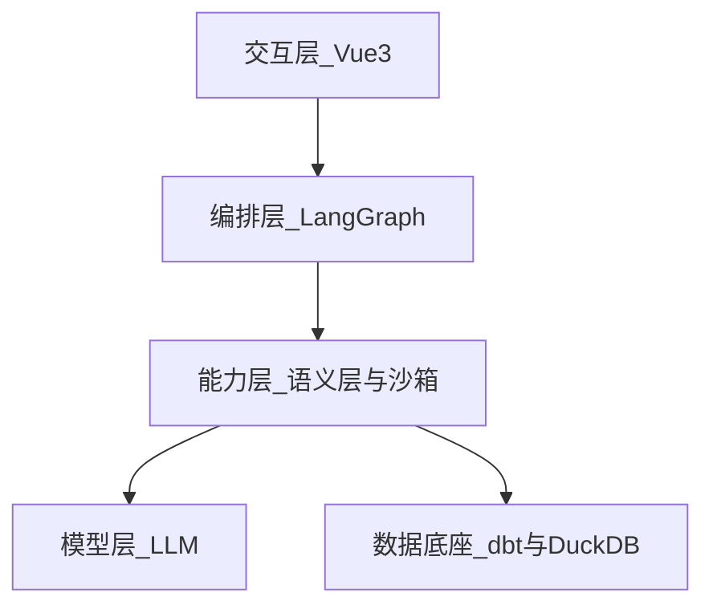

# 电商数据分析工作台 · 产品计划书（最终版）

> 版本：最终版  
> 日期：2026-10-08  
> 定位：面向不懂 SQL 的运营与管理者的引导式数据分析决策工作台。首个落地领域为电商资源包 `EC_V1.0`。  
> 用途：统一产品范围、分析引擎、数仓模型和 8 周交付标准，作为后续设计与开发的唯一依据。

本文中的界面数字、正确率、成本和延迟，凡未标明「评测实测」，一律是形态示意，不能当作已达成结果。

---

## 1. 版本说明与材料取舍

本计划书综合以下五份材料，冲突处只保留一套结论。

| 材料 | 采纳内容 |
|---|---|
| 《电商数据分析工作台产品设计方案 V1.0》（2026-10） | 产品定位、用户、竞品边界、引导式工作台、三段式回答、体验验收 |
| 《电商经营分析 Agent · 项目全案》（2026-09） | 分析引擎、语义层、评测闭环、18 张领域表的字段级定义、安全沙箱、8 周工程节奏、BYOK |
| 《DataAgent 智能分析子系统设计说明》 | 平台实体：账号、资源包版本、数据源、查询任务、图表与看板、对话与反馈 |
| 《数据分析 Agent · 实体设计说明》 | 18 张领域表的业务解释 |
| 《电商数仓建模设计说明》 | ODS / DWD / DWS / ADS 四层、订单明细粒度、星型模型、时间维与可选地区维 |

正文采用的决定如下。

1. **产品主形态是引导式决策工作台。** 用户打开的是资源包和工作台，主入口是「看大盘 / 看趋势 / 看结构 / 找异常」。自然语言和追问保留，用来下钻，结果走报告卡。
2. **默认回答是三段式**：结论、数据支撑、行动建议。完整报告卡是五件套：结论、证据、图表、建议、追问。SQL 与口径默认折叠，点击展开。
3. **分析引擎**按「规划 → SQL 生成 → 沙箱校验 → 归因 → 报告」运行，并保留澄清分支和评测回流。对外把这条链路说成八步。
4. **内核与资源包解耦。** 首版只上线电商包 `EC_V1.0`。金融 `FN`、教育 `ED`、通用示例 `GM` 只保留编码和界面扩展位。一个资源包包含数据集、表结构、指标口径、业务规则、few-shot 样例、评测集和推荐问法。
5. **现在要建的系统**分五层：交互、编排、能力、模型、数据底座，外加安全、评测、追踪、成本四条横切。Nginx、Redis 集群、MySQL 只读从库、企业微信或飞书 SSO，写入 V1.2 之后的容量方案。
6. **第一版技术栈**：FastAPI、LangGraph、DuckDB、dbt、Vue3、ECharts。既有静态 HTML 原型只作交互参考。
7. **数仓四层**：ODS → DWD → DWS → ADS。DWS 和 ADS 都只从 DWD 聚合，不读 ODS。DWD 粒度是订单明细。维度为用户、商品、类目、渠道、时间；地区维可选。DWS 为用户日汇总和商品日汇总。问数和看板的主表是 ADS 的 `ads_trade_daily`（天 × 渠道 × 类目 × 城市），因其粒度与两张 DWS 表不同，直接由 DWD 聚合，不从 DWS 回推。
8. **实体分两类。** 平台实体管人和系统；领域实体是电商包里的 18 张表。DWS 的两张日汇总是物理模型，不计入这 18 张。
9. **指标口径以全案为准**，见第 9 章。渠道类型统一为自营、第三方、直播。搜索是行为来源，不作为渠道类型。
10. **行级权限由程序在 SQL 生成后拼接过滤条件。** 密钥默认使用平台密钥；用户自带密钥只存在服务端。
11. **可迭代、可持续是交付标准的一部分。** 新指标、新问法和新领域进资源包与评测集；编排节点保持稳定。每次改动先补用例再改口径，历史看板按保存时的口径版本和数据日期解释。机制见第 12 章。

---

## 2. 执行摘要

本产品让不懂 SQL 的人自己查数、看懂数、拿数做决定。它预置电商业务模型和指标口径，用四个分析方向把人带进分析，并用真实查询结果生成可展开核对的回答。分析结果可以保存为看板，留在团队里复用。

第一版只做电商资源包 `EC_V1.0`。技术上，引导式界面背后是一条可校验的分析链路：理解问题、按口径生成 SQL、在只读沙箱执行、做归因、输出报告，并把每次问答记入日志，用来回归评测。

建议按 8 周、三个里程碑交付。第 1–3 周跑通电商单包、看大盘、看趋势和三段式回答。第 4–6 周补齐四个方向、保存看板、语义层、归因和 20–50 条评测。第 7–8 周补上 dbt 质量门、链路追踪和成本统计，并用真实非技术用户验收：10 分钟内独立完成一次分析，并且能看懂。8 周结束时，失败问答要能变成新的评测用例，口径和数据日期要能在回看时对上。

首版明确不做：多个已上线资源包、多租户、移动端原生应用、开放平台、订阅推送和语音提问。

---

## 3. 定位、用户与原则

### 3.1 一句话定位

让不懂 SQL 的人，自己查数据、看懂数据、拿数据做决策。交付物是决策支持：结论、数据支撑、行动建议，而不是一行孤立数字，也不是一张需要分析师翻译的报表。

### 3.2 要解决的五个问题

| 问题 | 产品上怎么解 |
|---|---|
| 不知道问什么 | 四个方向按钮、示例问题和推荐问法，把空白输入变成点选 |
| 看不懂结果 | 三段式回答，结论用业务语言，关键数字进指标卡和图表 |
| 不敢相信答案 | 回答只基于数仓查询结果；证据区可展开 SQL、口径和来源表 |
| 分析无法沉淀 | 保存看板，支持回看；收藏对话、图表和看板 |
| 企业数据不能外泄 | 数据留在自有数仓；查询走只读账号；权限和审计由代码执行 |

### 3.3 目标用户

| 角色 | 特征 | 诉求 | 典型问题 |
|---|---|---|---|
| 运营专员 | 懂执行，不会 SQL，取数要排队 | 自己随时查数 | 昨天各渠道订单量是多少 |
| 运营经理 | 关注波动和归因 | 定位拖累项，判断投入 | 哪个品类拖累了整体增长 |
| 业务负责人 | 对月度结果负责 | 复盘和汇报有依据 | 本月 GMV 表现如何 |
| 老板 | 只看结论，决策周期短 | 一句话看清现状和风险 | 这个月该重点抓哪个指标 |

系统角色与业务角色分开。系统角色是管理员、数据分析师、普通用户，用来控制谁能管理资源包、谁能看哪些数据。上表四类是工作台里的使用场景，默认落在「普通用户」或「数据分析师」。

### 3.4 三条产品原则

1. **零门槛。** 新用户从打开页面到完成第一次分析，路径上不出现必须手写 SQL 或理解数仓分层的步骤。体验验收是 10 分钟内独立完成并看懂。
2. **可溯源。** 每条结论都能展开到数据来源和对应 SQL。
3. **可沉淀。** 一次分析可以保存、回看、分享，成为个人或团队资产。

界面另外遵守两条体验规则，服务于上面三条：同一指标全站同一口径、同一配色；SQL 和口径默认收起，需要核对时再打开。

---

## 4. 竞品与边界

### 4.1 三类可替代方案

| 维度 | 通用 AI 对话 | 传统 BI | 本产品 |
|---|---|---|---|
| 数据连接 | 连接不到企业数仓 | 能连接，依赖人工建模 | 资源包预置模型和口径 |
| 提问门槛 | 低，但不知道能问什么 | 高，要先会做报表 | 方向按钮加示例问题 |
| 答案可信 | 可能编造，无法核对 | 数字真实，只给报表 | 基于查询结果，可展开 SQL |
| 业务纵深 | 没有领域指标体系 | 有通用模板 | 电商包预置指标和推荐问法 |
| 数据合规 | 数据离开企业环境 | 数据不出域 | 数据不出域，加权限和审计 |
| 结果沉淀 | 问完即散 | 报表可留存 | 看板可保存、回看、分享 |

### 4.2 本产品做什么

围绕已经接入的电商数据，完成四件事：看整体、按方向分析、下钻归因、把结果存成看板。

### 4.3 明确不做

- 通用问答、文案创作，以及与通用聊天产品比拼的泛化能力
- 算法训练、预测建模等数据科学平台能力
- 拖拽式报表设计器，以及要求用户自己理解维度和度量后再搭表
- 第一版的多资源包上线、多租户、移动端原生应用、开放平台、订阅推送、语音提问

范围收在「让非业务人员围绕已有数据完成理解和决策」。

---

## 5. 产品形态与页面

### 5.1 输入与输出

用户侧输入是业务意图，由四部分组成。

| 输入 | 说明 |
|---|---|
| 分析动作 | 点击某个方向、示例问题、追问，或在追问框输入自然语言 |
| 约束 | 时间范围、品类、渠道、地区；来自分析页筛选条或对话补全 |
| 会话上下文 | 多轮追问时继承上一轮的指标和时间口径 |
| 身份与权限 | 决定可见的资源包和数据行 |

用户第一眼看到三段式。展开后的报告卡是五件套。

| 输出 | 默认是否展开 | 内容 |
|---|---|---|
| 结论 | 展开 | 业务结论，附置信度；假设和数据截止日期一并写明 |
| 数据支撑 | 展开 | 关键数字和与问题匹配的图表 |
| 行动建议 | 展开 | 下一步可执行的建议 |
| 证据 | 折叠 | 生成的 SQL、所用口径、来源表和血缘 |
| 追问 | 展开 | 下钻到单品、更换维度等引导 |

### 5.2 五个界面

登录后，顶部栏在各页保持同一套入口。五个界面各管一件事。

| 界面 | 核心内容 | 用户动作 |
|---|---|---|
| 首页 | 四张指标卡、数据日期、最近看板 | 看整体，点进某一次分析或某个看板 |
| 分析 | 用或不用资源包、上传对应数据、保存数据，再进入方向和报告卡 | 选定数据后做分析，结果保存到看板 |
| 资源包 | 资源包卡片与当前包说明 | 查看 `EC_V1.0` 的指标、推荐问法和版本。其余包置灰 |
| 数据 | 历史数据集、连接状态；后续补质量报告和血缘 | 查看以前保存的数据，并拿去分析 |
| 个人中心 | 头像、个人设置、个人配置、退出 | 修改头像和个人信息；调整使用偏好 |

`EC_V1.0` 在资源包页标明：覆盖订单、支付、退款和用户行为；预置 8 个核心指标与约 20 条推荐问法。金融、教育、通用示例包置灰，标注未安装。

### 5.3 分析页

分析页先准备这一次要用的数据，再对已保存的数据做分析。进入页面时，主区是三步：选择用不用资源包、上传对应数据、保存数据内容。四个方向和报告卡在数据保存之后才出现。

桌面内容区宽 1200px。未保存数据时，页面只显示准备区。

```text
这一次用哪份数据

(●) 使用资源包                 ( ) 不使用资源包
电商 · EC_V1.0 ▾               金融、教育、通用示例未安装

上传对应数据
订单          [选择文件]  未上传
订单明细      [选择文件]  未上传
用户          [选择文件]  未上传
商品          [选择文件]  未上传
行为          [选择文件]  未上传

数据内容
文件名、列、行数、前 5 行

[保存数据]

历史数据集
名称            资源包         行数      保存时间         操作
电商订单_1008   EC_V1.0       12,480    10-08 15:40     [查看内容] [用于分析]
试用表_1001     未使用资源包      320     10-01 09:12     [查看内容] [用于分析]
```

选「不使用资源包」时，没有指标口径和固定文件槽，改为上传一份或多份 CSV，由用户填写数据名称。

| 步骤 | 界面 | 规则 |
|---|---|---|
| 使用资源包 | 单选「使用资源包」，再选已安装的包。首版只有 `EC_V1.0` 可选，其余包可见但不可选 | 页面列出该包要求的数据：订单、订单明细、用户、商品、行为。口径、推荐问法和四个方向都来自这个包 |
| 不使用资源包 | 单选「不使用资源包」 | 不套用包内指标和推荐问法。后续分析按上传文件里的列来提问，报告卡标明「未使用资源包」 |
| 上传对应数据 | 每个要求的文件一个上传位，显示文件名和是否已选 | 使用资源包时，列名需能对上该包的字段；缺列时指出缺哪一列，不允许保存。文件格式为 CSV |
| 保存数据内容 | 预览列、行数和前 5 行，确认后点击「保存数据」 | 原始文件按账号隔离保存且不可覆盖。每次保存新增一条历史数据集，不替换以前的记录。记录名称、是否绑定资源包、资源包编码、字段、行数、保存时间 |
| 历史数据集 | 保存在本账号下的全部数据集，按保存时间从新到旧排列 | 只显示当前用户的数据。尚无记录时写「还没有历史数据集」。查看内容打开列、行数和前 5 行。用于分析后，分析区只查询这一条 |

点「用于分析」后，下面的分析区才展开。同一条历史数据集可以反复选用。新保存的一条立刻出现在列表第一行，分析页和数据页看到的是同一份列表。

数据保存并选定之后，分析区如下。日期和结论句是示意。

```text
正在分析：电商订单_1008 · EC_V1.0 · 12,480 行

[今天] [本周] [本月] [自定义]    数据范围 ▾     数据至 10-07 · 口径 v1.0          [保存到看板]

总览  ›  下钻  ›  归因

[看大盘]  [看趋势]  [看结构]  [找异常]
品类 ▾    渠道 ▾    地区 ▾

从这里开始
[昨天各渠道订单量是多少]  [本月 GMV 表现如何]  [哪个品类拖累了增长]

数据流程
1 数据来源   电商订单_1008 · 订单.csv 等 5 个文件 · 保存于 10-08 15:40 · EC_V1.0
2 口径       GMV v1.0 · 支付成功的实付金额 · 含退款
3 生成查询   已生成 · 查看 SQL
4 校验       只读 · 已限制行数 · 通过
5 读数       ads_trade_daily · 数据至 10-07 · 返回 30 行
6 计算       用返回结果算环比与渠道贡献
7 结论       已写出

结论
本月 GMV 较上月上升，主要由自营渠道贡献。          置信度 高
[图表]
建议
先看自营渠道里上升最快的类目。
追问  [哪个渠道贡献最大]  [下钻到单品]  [改看净 GMV]

[继续问，例如：换成上周]                              [发送]
```

| 区块 | 内容 |
|---|---|
| 当前数据 | 显示正在使用的历史数据集。可改选另一条，或回到上方重新上传 |
| 页面筛选条 | 时间（今天、本周、本月、自定义）、数据范围、数据日期与口径版本、保存到看板。未使用资源包时不显示口径版本 |
| 分析路径 | 总览、下钻、归因三步。当前步高亮 |
| 四个方向 | 看大盘、看趋势、看结构、找异常。未使用资源包时这四个方向不可用，只保留底部追问 |
| 维度 | 品类、渠道、地区。使用资源包且到 M2 时出现，默认「全部」 |
| 引导区 | 使用资源包且尚未出结果时，展示该包的 3 条推荐问法 |
| 结果区 | 报告卡，结构见 5.5。数据流程和数据来源始终可见。输出偏好只改变结论文字和证据展开程度 |
| 底部追问 | 单行输入，针对当前已保存数据提问 |

四个方向的含义：

| 方向 | 回答的问题 | 默认图表 | 可用时间 |
|---|---|---|---|
| 看大盘 | 当前整体水平如何，和上一期比怎样 | 四项关键数字加环比，配一张渠道对比柱状图 | M1 |
| 看趋势 | 指标随时间怎么变 | 折线图，带环比标注 | M1 |
| 看结构 | 构成和占比，谁贡献了多少 | 环形图或瀑布图 | M2。M1 按钮可见，标注即将开放，不可点 |
| 找异常 | 哪里偏离了常态，值得先看 | 偏离最大的维度用柱状图标出 | M2。M1 同样可见但不可点 |

维度选择支持时间、品类、渠道、地区组合，例如「华东地区最近 30 天各品类 GMV」。时间以筛选条为准。点击图表中的品类或渠道，路径进入下钻，并生成下一张报告卡。

页面有六种状态：

| 状态 | 主区表现 |
|---|---|
| 待准备 | 只显示资源包选择、上传和保存。分析区不出现 |
| 待选用 | 历史数据集里已有记录，但还没点「用于分析」。分析区不出现 |
| 引导 | 已选定数据。使用资源包时给出四个方向和 3 条推荐问法 |
| 进行中 | 数据流程逐步点亮当前步骤，例如「正在读数」。同一时刻只跑一轮。失败停在出错的那一步 |
| 结果 | 展示报告卡 |
| 澄清 | 用一句话提问，并给出可点的选项。选定后再继续查询 |
| 失败 | 上传对不上资源包字段，或查询失败时，说明缺什么或失败原因，并允许重新上传或再试一次 |
| 范围已变 | 筛选条出现「范围已变，重新分析」。确认后按新时间或新数据范围重算当前问题 |

筛选条的规则：

- 切换时间或数据范围后，首页指标卡与下一次分析使用新约束。分析页若已有报告卡，筛选条提示「范围已变，重新分析」，用户确认后再发起。
- 数据日期来自 ADS 的 `data_date`，口径版本来自当前资源包。落后于预期的 T+1 时，文案写「数据至某日，尚未更新到最新」。仍在使用上一版 ADS 时，文案写「数据至某日，沿用上一版」。
- 还没有可保存的分析结果时，「保存到看板」不可点。保存时写入当时的时间、数据范围、口径版本和数据日期。
- 报告卡上的含退款 / 净 GMV、周 / 月 / 季、环比 / 同比只作用于这张卡。卡上提供「用到整个工作台」，确认后更新筛选条的口径说明，并刷新首页指标卡。

### 5.4 顶部栏

顶部栏是全站导航，固定在页面顶端，高度 56px，滚动时保持可见。它负责在五个界面之间跳转，不放时间、数据范围和保存按钮。那些控件在分析页的筛选条里。

桌面宽度按 1280px 设计：

```text
[标] 电商分析工作台          首页    分析    资源包    数据    个人中心          (头像)
```

当前所在项高亮。点击任一项切换主区，登录状态保持不变。从分析页离开再回来，保留本次会话里的时间范围和未保存的报告卡。右侧头像与「个人中心」进入同一页；尚未上传头像时显示昵称首字。

| 入口 | 进入后看到 | 首版范围 |
|---|---|---|
| 首页 | GMV、订单量、转化率、退款率四张卡，各带环比；数据日期；最近保存的看板 | M1 显示指标卡。看板列表在 M2 有保存能力后出现 |
| 分析 | 先选择用或不用资源包，上传对应数据并保存，再对已保存数据做分析 | M1 完成选择、上传、预览、保存，以及保存后的看大盘、看趋势。M2 补齐四个方向和保存到看板 |
| 资源包 | 当前包 `EC_V1.0` 的指标、口径版本、推荐问法。其他包可见但不可进入 | M1 可打开。未安装包置灰 |
| 数据 | 历史数据集全表、连接状态 | 与分析页共用同一份历史数据集。本页可查看内容，并跳回分析页用于分析。质量报告和血缘在 M3 打开 |
| 个人中心 | 头像与个人设置、个人配置、退出 | M1 可查看并修改头像、昵称、邮箱、手机号和密码。密钥、指标组、输出偏好在 M3 打开。分析师的评测、成本与延迟也放在这里，数字来自评测实测 |

宽度不足 900px 时，五个入口收进菜单，产品标识保留在栏内。顶部栏不放置 SQL、追踪编号，也不放置未经评测的正确率。

### 5.5 报告卡与图表

报告卡先展示数据流程，再给结论。顺序是：数据流程 → 结论与置信度 → 口径和时间开关 → 图表 → 归因细节 → 建议 → 追问。流程里的每一步都标明状态：等待、进行中、完成或失败。

数据来源写在流程第 1 步，不收进折叠区。至少包括：

| 项 | 写什么 |
|---|---|
| 数据集 | 历史数据集名称 |
| 文件 | 本次用到的原始文件名。使用资源包时列出订单、订单明细、用户、商品、行为中实际参与的文件 |
| 保存时间 | 这条历史数据集的保存时间 |
| 资源包 | `EC_V1.0`，或「未使用资源包」 |
| 读取位置 | 实际查询的表。使用资源包时写到 ADS 或 DWD 的表名；未使用资源包时写上传文件对应的表 |
| 数据日期 | ADS 的 `data_date`。未使用资源包时改为文件内的时间范围 |

使用资源包时，完整流程固定为七步：

| 步 | 用户看到 | 点开后 |
|---|---|---|
| 1 数据来源 | 数据集、文件、保存时间、资源包 | 文件列表和行数 |
| 2 口径 | 指标名、口径版本、一句话定义 | 第 9 章那条规则的原文 |
| 3 生成查询 | 「已生成」 | 本次 SQL |
| 4 校验 | 只读、行数上限、是否通过。M2 起写明已按权限过滤 | 被拒绝的原因 |
| 5 读数 | 表名、数据日期、返回行数 | 结果的列名，不默认铺开全部行 |
| 6 计算 | 环比、占比或贡献来自第 5 步的结果 | 所用公式 |
| 7 结论 | 「已写出」 | 回到卡片上的结论文字 |

未使用资源包时去掉第 2 步，并在第 1 步标明没有套用资源包口径。查询直接针对该历史数据集的列。

输出偏好仍然有效，但不隐藏流程和第 1 步的数据来源。汇总结论缩短建议和图表；完整报告默认展开 SQL。首页指标卡在数字下方写同一条数据来源，避免首页和报告卡各说各的。

保存到看板时，连同这七步和数据来源一起保存。回看时仍显示当时的数据集名称、文件、口径版本和数据日期。

图表必须匹配问题。

| 问题 | 图表 |
|---|---|
| GMV 等指标的时间变化 | 折线图，带环比标注 |
| 渠道或品类对涨跌的贡献 | 瀑布图或堆叠柱 |
| 排名对比 | 柱状图 |
| 占比 | 环形图 |
| 浏览到购买的流失 | 漏斗图 |
| 用户价值分布 | 直方图或箱线图 |

口径开关至少包括：GMV 含退款 / 净 GMV、时间粒度（周 / 月 / 季）、环比 / 同比。切换开关后按同一口径重算，而不是只改文案。

### 5.6 个人中心

个人中心分成个人设置和个人配置。个人设置对应用户实体，M1 即可查看和修改。个人配置对应领域实体里的个人配置表，在 M3 打开。

页顶是身份摘要：圆形头像、昵称、登录账号和系统角色。点击头像或「更换头像」上传新图片，保存后顶部栏右侧的头像同步更新。未上传时，头像位显示昵称的第一个字。

**个人设置**

| 项 | 是否可改 | 规则 |
|---|---|---|
| 头像 | 可改 | 上传 JPG 或 PNG，保存为头像地址。页面内可预览，确认后写入用户实体 |
| 昵称 | 可改 | 显示在个人中心和需要展示姓名的位置 |
| 邮箱 | 可改 | 用于找回和通知，需符合邮箱格式 |
| 手机号 | 可改 | 选填，填写时校验位数 |
| 登录账号 | 可改 | 全站唯一。修改前确认，保存时检查是否与他人重复 |
| 密码 | 可改 | 单独入口。需填写当前密码和新密码；只保存 bcrypt 哈希，页面不回显原密码 |
| 系统角色 | 只读 | 管理员、数据分析师或普通用户，由管理员分配 |
| 账号状态 | 只读 | 启用、禁用或待激活 |

修改后点击「保存」才写入。保存成功后停留在本页，并提示已更新。校验不通过时停在对应字段，不提交其余项。退出登录放在本页底部。

**个人配置**

| 配置项 | 行为 |
|---|---|
| 密钥状态 | 默认平台密钥。高级用户可绑定自有密钥；明文只出现在本机表单，提交后由服务端加密保存 |
| 资源包 | 已安装包列表。首版只有 `EC_V1.0` 可启用 |
| 分类树 | 指标的归属，例如经营分析 → 流量 / 交易 / 用户。一个指标只挂一个分类。点选分类后，该分类口径进入本轮上下文 |
| 指标组 | 用户自己的打包，例如把转化率和复购率收成「健康度组」。一个指标可以进入多个组。提问时可引用组名 |
| 输出偏好 | 三档：汇总结论、结论加图表、完整报告（含 SQL 与血缘）。另有默认时间范围 |

用户自建指标只允许选择字段和聚合方式（sum、count、avg、rate）。更复杂的表达式走受控校验，不能变成任意 SQL。

### 5.7 前端实现

第一版前端用 Vue3 和 ECharts，通过 REST 与 FastAPI 对接，桌面优先，做基础响应式。移动端原生应用不在本版范围。视觉只遵守 5.8。

既有 HTML 原型只用来核对页面里有哪些区块。原型里的玻璃、渐变和发光不进入最终界面。原型中的百分比、金额和延迟是示意。

### 5.8 设计规则

规则尽量少，五个页面共用。

1. **黑底浅字。** 页面底 `#07080d`，卡片 `#12151c`，字 `#e7e1d5`。次要说明用 `#8b93a7`。
2. **颜色只表达状态。** 涨和当前步骤用 `#d6a15a`，跌和失败用 `#c45c4a`。
3. **两种字。** 标题用思源宋体，其余用思源黑体。数字和 SQL 等宽。
4. **鼠标只亮边。** 指针下的卡片出现一条细亮边。背景星点可以轻轻跟着指针动。开启减少动态时，星点不动，亮边改为固定细线。
5. **一页一件事。** 首页看数，分析页准备数据再出结论，资源包看包，数据页看历史数据集，个人中心改自己的资料。

---

## 6. 一次分析怎么走完

### 6.1 对外八步

一次分析在数秒到数十秒内走完。M1 的响应验收是单次不超过 30 秒。

| 步骤 | 用户可感知的事 | 系统内部 |
|---|---|---|
| 1. 进入 | 点方向、点示例，或输入追问 | 鉴权、带上资源包 `EC_V1.0` 和会话 |
| 2. 听懂 | 条件不清时先追问，例如时间或口径不明 | 意图识别；用会话补全「那上周呢」这类省略 |
| 3. 带上业务含义 | 流程显示数据来源和口径 | 注入该资源包的表结构、指标口径、规则和少量样例 |
| 4. 写成查询 | 流程停在「生成查询」，完成后可查看 SQL | 在表白名单和口径约束下生成 SQL |
| 5. 拦住危险查询 | 流程停在「校验」，失败时停在这一步并说明原因 | 只读校验、危险关键字拦截、LIMIT 和超时。自 M2 起，再由程序追加行级权限 |
| 6. 查出数 | 流程停在「读数」，写明表名、数据日期和返回行数 | 在只读连接上执行；检查空结果和异常波动 |
| 7. 写成回答 | 流程停在「计算」然后「结论」，再展示三段式 | 只用查询结果计算指标、环比同比和贡献；禁止在没有查询结果时编造数字 |
| 8. 留下记录 | 可保存看板、可点追问 | 写入问答日志；相同问题可走缓存；失败案例回流评测集和口径 |

### 6.2 对内节点

编排层用 LangGraph 把下面的节点串成「宏观流程固定、节点内可以重试」的链路。

| 节点 | 职责 | 对应八步 |
|---|---|---|
| 输入 | 接收方向、示例、追问和身份 | 1 |
| 澄清 | 意图或口径不明时反问，不继续生成 SQL | 2 |
| 规划 | 拆成「先确认事实，再拆原因」的子任务 | 2 |
| 上下文组装 | 口径、Schema、历史、规则合成一条约束提示 | 3 |
| SQL 生成 | 受 schema 白名单、口径和 few-shot 约束 | 4 |
| 沙箱执行 | 只读、LIMIT、超时；M2 起追加行级过滤 | 5、6 |
| 校验 | 语法检查（EXPLAIN）和口径自检；失败则重写，有次数上限 | 5 |
| 质量确认 | 空值、异常波动 | 6 |
| 归因 | 指标、环比同比、维度拆解、贡献度 | 7 |
| 报告 | 组装三段式和五件套 | 7 |
| 反馈 | 渲染、追问循环、写 `qa_log`，必要时补评测用例 | 8 |

澄清未完成时停在第 2 步。校验失败时回到 SQL 生成，不把失败 SQL 的结果展示成结论。

### 6.3 离线准备

在线链路依赖一套事先建好的数据底座，构建一次、按日刷新：

1. 接入 CSV（后续再统一 MySQL 等来源），原始文件按用户目录隔离且不可变。
2. 做空值、重复、异常和主键探查，形成质量报告。
3. 用 dbt 建成四层模型，加工层可以整库重建。
4. 质量测试：主键唯一、金额非负、行数波动告警。不通过则不刷新对外的 ADS。
5. 发布语义层：指标字典、维度映射、业务规则，作为 SQL 生成的唯一口径来源。
6. 记录血缘：指标 → SQL → 源表 → 数据集。
7. T+1 刷新，ADS 带数据日期。报告卡上的时效以该日期为准。

问答日志回流做两件事：给评测集加用例，防止改动后退化；把反复失败的问法回写到口径说明或 few-shot，提高后续命中率。


---

## 7. 架构与技术栈

### 7.1 第一版实现架构

| 层 | 职责 | 第一版组件 |
|---|---|---|
| 交互层 | 工作台、登录、会话展示 | Vue3、ECharts |
| 编排层 | 节点、分支、重试 | LangGraph |
| 能力层 | 工具、语义层、只读执行、记忆 | 语义层配置、沙箱、元数据 |
| 模型层 | 生成 SQL 和把结果写成回答 | OpenAI 兼容的 LLM API；密钥只在服务端 |
| 数据底座 | 分层数仓、原始文件、元数据 | DuckDB、dbt、本地按租户隔离的原始文件 |

四条横切从 M1 就有最小实现，到 M3 补齐：

| 横切 | M1 最小实现 | M3 完成标准 |
|---|---|---|
| 安全 | 登录 JWT、只读执行、LIMIT、超时 | M2 完成行级权限强制拼接；M3 做到审计可回放 |
| 评测 | 10 条评测用例 | 20–50 条，改动后可回归 |
| 追踪 | 查询任务记录问题、SQL、状态、耗时、错误 | 全链路 trace，能指出失败发生在哪一个节点 |
| 成本 | 记录是否调用模型 | 按用户统计 token 与费用；高频问题可缓存 |



### 7.2 第一版技术选型

| 层级 | 选型 | 用途 |
|---|---|---|
| 前端 | Vue3、ECharts | 工作台、报告卡、图表 |
| 应用 | FastAPI | 鉴权、上传、问答接口、流式状态 |
| 编排 | LangGraph | 规划、SQL、校验、归因、报告 |
| 缓存 | 进程内或单机缓存即可 | 相同问题短时复用；集群化放到容量方案 |
| 数仓 | DuckDB、dbt | 四层模型与质量测试 |
| 模型 | OpenAI 兼容 API | 问题转 SQL、结果转回答 |

V1 的数据入口是 CSV 上传，进入 DuckDB。平台上的数据源类型预留 MySQL、Hive、PostgreSQL 和 CSV。统一接入接口放在 M3，不作为 M1 的阻塞项。

### 7.3 V1.2 之后的容量方案

当需要多用户同时使用、对接企业身份和独立数仓时，再升级为下面的形态。它不进入前 8 周的验收。

| 层级 | 目标组件 | 目的 |
|---|---|---|
| 用户入口 | Web，并可扩展企业微信、飞书、钉钉 | 企业内入口 |
| 接入 | Nginx：HTTPS、负载均衡、限流 | 统一入口 |
| 应用 | FastAPI 无状态多实例 | 横向扩展 |
| 缓存与异步 | Redis：问答缓存、会话、限流计数 | 降低模型调用次数 |
| 数据 | MySQL 或云数仓的只读从库 | 与生产写入隔离 |
| 身份 | 企业微信或飞书 SSO，JWT 短期令牌 | 企业账号 |

容量策略的优先级是：先用问题归一化缓存和热门指标预计算减少模型调用，再增加应用实例。查询始终走只读连接，并限制返回行数。

---

## 8. 电商资源包：数仓与实体

### 8.1 资源包 `EC_V1.0`

| 项 | 约定 |
|---|---|
| 编码 | `EC_V1.0`。`EC` 表示电商。表结构不兼容变更时主版本加 1；新增表或字段时次版本加 1 |
| 状态 | 首版为已上线。`FN`、`ED`、`GM` 保持未安装 |
| 内容 | 数据集、四层模型、8 个核心指标、业务规则、few-shot、评测集、约 20 条推荐问法 |
| 隔离 | 资源包之间数据、口径和评测集互相不可见 |

8 个核心指标是：GMV、订单量、支付买家数、转化率、客单价、退款金额、退款率、复购率。

### 8.2 四层数仓

每一层只做自己的事。DWS 与 ADS 都从 DWD 聚合，不直接读 ODS。

| 层 | 职责 | 本包中的落点 |
|---|---|---|
| ODS | 原样接入，不清洗，用于追溯和重跑 | 订单、订单明细、用户行为及各维度的贴源表 |
| DWD | 清洗、去重、统一格式后的维度、事实和明细宽表 | `dim_*`、`fact_*`，以及粒度为一笔订单中一个商品的 `dwd_order_detail` |
| DWS | 按主题轻度聚合，服务高频问题 | 用户购买日汇总、商品销售日汇总 |
| ADS | 面向看板和问数的业务宽表 | `ads_trade_daily`：天 × 渠道 × 类目 × 城市 |

订单明细事实表只保留可聚合的度量（件数、优惠、实付等）和维度外键。类目是高频分析维度，允许在事实表中冗余类目标识，减少每次按类目统计时的关联。描述性属性（性别、品牌、渠道类型）放在维度表，不在事实表重复存放。

星型关系以订单明细事实表为中心：

- 关联用户维：谁买的
- 关联商品维、类目维：买了什么
- 关联渠道维：从哪个渠道来
- 关联时间维：哪天买的。时间维展开年、季度、月、周、星期、是否周末，避免每次用日期函数现算
- 地区维可选：省、市。未建地区维时，城市取自用户维

DWS 两张表从 DWD 聚合，不单独定义另一套口径。用户日汇总回答「某人某天买了几单、花了多少」；商品日汇总回答「某商品某天卖了多少件、多少钱」。`ads_trade_daily` 同样从 `dwd_order_detail` 聚合。它的粒度是天 × 渠道 × 类目 × 城市，覆盖不了的维度组合不从这两张日汇总回推。看板和按该粒度的问数优先读 ADS。需要订单行或单品明细时读 DWD。

`dim_*` 与 `fact_*` 是清洗后的维度表和事实表，放在 DWD，供 `dwd_order_detail` 关联。ODS 只保留同名业务数据的贴源副本，不对外作为问数来源。时间维放在 DWD；地区维未建时，城市取自 `dim_user`。

加工层可按 dbt 重建。原始 ODS 文件不可变。

### 8.3 平台实体

平台实体描述账号、资源包和一次次问答，与电商业务表分开。下列每张表在需要留痕时带创建人、创建时间、修改人、修改时间；需要删除时使用删除时间戳，空值表示未删除。

| 实体 | 记录什么 | 为什么存在 |
|---|---|---|
| 用户 | 登录账号、bcrypt 密码哈希、昵称、头像地址、邮箱、手机号、系统角色、账号状态 | 身份。头像、昵称、邮箱、手机号、登录账号和密码可在个人中心修改；角色与账号状态只读。不存密码明文 |
| 角色 | 管理员、数据分析师、普通用户，以及可访问的资源包 | 权限边界 |
| 用户会话 | JWT、过期时间、登录 IP、设备 | 登录态 |
| 资源包 | 名称、编码、业务域、版本、状态、默认数据源、推荐问法 | 领域能力的安装单元 |
| 资源包表 | 表名、中文名、所属层级、字段结构、是否维度表 | 告诉模型和元数据服务有哪些表 |
| 资源包指标 | 指标名、编码、口径说明、计算片段、关联表、默认图表 | 与语义层指标字典对齐的产品侧入口 |
| 数据源 | 类型、连接信息、AES 加密后的密码、连通状态 | 包所挂的数据从哪里来 |
| 查询任务 | 原始问题、意图、SQL、执行状态、结果、耗时、行数、错误 | 一次取数的技术记录 |
| 图表模板 | 图表类型、所属包、关联指标、配置 | 开箱图表，保证选型一致 |
| 看板 | 名称、布局、筛选器、是否公开 | 分析结果沉淀 |
| 对话历史 | 问题、回答、关联的查询任务、图表类型、业务洞察 | 多轮上下文和回看 |
| 收藏 | 收藏的对话、图表模板或看板 | 个人资产 |
| 反馈 | 对某次回答的赞或踩，以及不准时的说明 | 评测和口径改进的入口 |

### 8.4 领域实体：18 张表

这 18 张表是电商包的共同语言。语义层和个人配置按领域区分，教育包将来各有一套，不改内核表结构。

**基础信息（4 张）——是谁、是什么**

| 表 | 粒度与关键内容 |
|---|---|
| `dim_user` | 每个用户一行：性别、年龄段、城市/省份、注册时间、渠道、会员等级、`is_test` |
| `dim_product` | 每个 SKU 一行：类目、品牌、商品名、标准售价、上架时间、状态 |
| `dim_category` | 每类目一行，树形：父级、名称、层级 |
| `dim_channel` | 每渠道一行：平台、店铺、渠道类型（自营 / 第三方 / 直播） |

**业务记录（3 张）——发生了什么**

| 表 | 粒度与关键内容 |
|---|---|
| `fact_order` | 每笔订单一行：下单/支付时间、状态、应付、优惠、运费、实付。支付状态是 GMV 口径的开关 |
| `fact_order_item` | 每笔订单中的每个商品一行：数量、单价、小计、退款状态和金额 |
| `fact_user_behavior` | 每次行为一行：浏览、加购、收藏、购买，以及来源页。转化漏斗的来源。搜索记在来源，不记成渠道类型 |

**加工结果（2 张）——算得快、算得一致**

| 表 | 作用 |
|---|---|
| `dwd_order_detail` | 订单明细关联订单、用户、商品、类目、渠道后的明细宽表。指标的明细级唯一来源 |
| `ads_trade_daily` | 按天、渠道、类目、城市预计算：GMV、订单量、支付订单数、买家数、UV、访问转化、下单转化、客单价、退款金额、复购买家数 |

DWS 的两张日汇总与 `ads_trade_daily` 一样，口径都从 `dwd_order_detail` 推导，只是聚合粒度不同，不单独对外承诺另一套数字。

**口径与质量（5 张）——算得对、效果可验证**

| 表 | 作用 |
|---|---|
| `semantic_metric` | 指标名、领域、口径说明、表达式、过滤规则、来源表、口径版本 |
| `semantic_dimension` | 维度名到字段的映射，例如「城市」去哪张表的哪一列 |
| `semantic_rule` | 全局规则：剔除测试账号、环比同比算法、时间用支付时间 |
| `eval_case` | 自然语言问题、期望指标或断言、难度、领域、状态 |
| `qa_log` | 问题、SQL、结果、是否正确、token 成本、延迟、trace、所用模型和密钥来源 |

**个人配置（4 张）——每个用户怎么用**

| 表 | 作用 |
|---|---|
| `metric_category` | 指标分类树。一个指标只属于一个分类 |
| `metric_group` | 用户自建指标组，可公开 |
| `metric_group_item` | 组与指标的多对多及排序 |
| `user_config` | 当前领域、密钥状态、输出偏好、图表偏好、默认时间范围 |

关系可以收成一条链：业务记录沉淀事实 → DWD / DWS / ADS 加工 → 指标字典定义口径 → 评测用例验收 → 问答日志回流。分类树和指标组只决定人如何找到指标，不改变指标算法。

### 8.5 数据集

首选阿里云天池「电商运营分析数据」（订单、用户、商品、行为）。体量过大时使用采样后的天池淘宝用户行为数据。原始文件按用户目录存放，例如 `data/tenant_{id}/raw/`，上传后不可覆盖。每次保存形成一条历史数据集，元数据记录归属、名称、是否绑定资源包、存储路径、字段结构、行数、保存时间和权限规则。分析页与数据页读取同一张列表。

---

## 9. 指标口径

以下口径写入 `semantic_metric` 和 `semantic_rule`，提示词、校验节点和看板共用，不允许界面另写一套。

| 指标 | 定义 |
|---|---|
| GMV | 支付成功订单的实付金额合计。按支付时间，不按下单时间。剔除未支付、取消，以及 `is_test = 1` 的用户。默认展示含退款的 GMV；切换为净 GMV 时减去退款金额。两套都要能展开到同一条规则 |
| 订单量 | 统计周期内的订单数，与 GMV 使用同一套状态过滤，除非该问题明确问的是「下单量」 |
| 转化率 | 两套并存且必须标注用的是哪一套。访问转化 = 支付买家数 / 访问 UV，数据来自行为日志。下单转化 = 支付订单数 / 下单订单数。禁止在同一次回答里混用而不说明。`ads_trade_daily` 分别落「访问转化」和「下单转化」两列，不合并成一个未命名的转化率字段 |
| 客单价 | 与当前 GMV 开关一致的金额 / 支付买家数 |
| 退款金额、退款率 | 退款金额来自订单明细的退款。退款率 = 退款金额 / 同期支付成功实付金额 |
| 复购率 | 自然月内购买不少于 2 次的用户数 / 同期购买用户数。周期若不是自然月，必须在结论里写明 |
| 测试数据 | `is_test = 1` 一律不进入指标 |

时间对齐、测试账号剔除、环比（相邻上一同期）和同比（去年同期）写成 `semantic_rule`，由校验节点核对，而不是只写在提示词里。

指标总览卡上的「转化率」默认使用访问转化；若行为日志不可用，卡片改为下单转化，并在卡片上写出口径名称。

---

## 10. 安全、权限与密钥

安全规则由代码执行。提示词可以提醒模型，但不能代替过滤条件。

| 环节 | 规则 |
|---|---|
| 登录 | 账号密码使用 bcrypt。会话使用短期 JWT。第一版用自建登录；企业 SSO 属于容量方案 |
| 上传 | 校验格式和大小。原始文件按用户隔离，写入后不可变 |
| 查询 | 只允许单条只读语句；表白名单限定在当前资源包；拒绝多语句和写操作；强制 LIMIT 和超时；使用只读数据库身份 |
| 行级权限 | 自 M2 起，SQL 生成之后由程序按用户的数据范围追加过滤条件，例如部门或数据集归属。模型生成的 SQL 无权自行放宽。M1 只做只读、表白名单、LIMIT 和超时 |
| 模型 | 用户输入当作数据，不当作指令。回答中的数字必须来自本次查询结果。敏感字段脱敏后再进入提示词和日志 |
| 审计 | 每次查询在 `qa_log` 和查询任务中留下问题、SQL、结果规模、耗时和操作者 |
| 密钥 | 默认平台密钥，来自服务端环境变量，不进入 Git，不进入前端。用户自带密钥用 AES 加密后存服务端，日志中不出现明文。前端只和自己的后端通信 |

个人配置里的「绑定密钥」在 M3 可演示。M1 只使用平台密钥。

### 10.1 模型 API 怎么计

这里的 API 指服务端调用的大模型接口。上传文件、保存历史数据集、登录和在 DuckDB 里执行 SQL 都不算模型调用。

用户每点一次方向、示例问题、追问或「重新分析」，记为一次分析。一次分析里面可以有多次模型请求。计费数的是模型请求，不是按钮点击。

单次请求的费用按调用当时模型返回的用量计算：

`费用 = 输入 token × 输入单价 + 输出 token × 输出单价`

一次分析的费用，等于这次分析里全部模型请求的费用相加。单价用来源方当时的公开价格，和 token 数一起写入 `qa_log`。之后调价不改已经记下来的金额。

一次分析里计入的请求只有这些：澄清意图、生成 SQL、校验失败后的重写、把查询结果写成三段式。环比、占比和贡献度用查询结果计算，不再为这些算术另调一次模型。

| 情况 | 怎么计 |
|---|---|
| 正常完成 | 上述几次请求的 token 和费用全部累加 |
| SQL 重写 | 每一次重写单独计一条请求 |
| 命中缓存 | 模型请求为 0，token 为 0，费用为 0，日志标记缓存命中 |
| 请求失败且来源方没有返回用量 | 记 0 token、0 费用，并记下失败原因 |
| 来源方已返回用量的失败或超时 | 按返回的 token 计，因为这部分通常已经产生费用 |
| 平台密钥 | 费用记在该用户名下，个人中心按日汇总 |
| 自有密钥 | 同样记录请求次数和 token。金额按同一单价估算，并注明实际扣费发生在用户自己的密钥账户 |

M1 先把每次分析的请求次数、输入 token、输出 token 写入日志。M3 在个人中心按用户汇总次数、token 和费用，并能点开看到是哪一次分析产生的。

---

## 11. 范围、里程碑与验收

### 11.1 版本范围

| 版本 | 目标 | 关键能力 |
|---|---|---|
| V1.0 / M1–M3（本计划，8 周） | 电商单包可用，并能量化效果 | 见下方三个里程碑 |
| V1.1 | 补分析深度 | 在 M2 已有的四个方向和维度组合之上，完善历史会话与图表联动 |
| V1.2 | 第二个包与主动服务 | 零售或教育包、每日早报、异常提醒、容量方案中的缓存和 SSO |
| V2.0 | 平台化 | 多租户、移动端、开放平台、企业聊天机器人入口 |

### 11.2 三个里程碑

**M1 · 第 1–3 周 · 跑通**

- 上传天池电商数据，ODS 可查询
- 顶部栏五个入口都可跳转；资源包页只有 `EC_V1.0` 可进入
- 分析页可选资源包或不选，上传对应 CSV，预览并保存；历史数据集可查看内容并再次用于分析；保存后可看大盘、看趋势
- 三段式回答来自真实查询；证据区能展开 SQL
- 只读沙箱、LIMIT、超时、JWT 登录
- 个人中心可更换头像，并修改昵称、邮箱、手机号、登录账号和密码
- 10 条评测；SQL 执行成功率不低于 80%；单次响应不超过 30 秒
- 问答日志记下问题、SQL、状态和错误，失败记录可以在后续里程碑补进评测集

**M2 · 第 4–6 周 · 做得对**

- 四个方向都可用，含看结构和找异常
- 保存看板、回看
- 语义层成为口径唯一来源；归因（环比同比、维度贡献）写入报告卡
- 行级权限由代码拼接
- 赞和踩写入反馈；指标字典带口径版本号。看板保存时记下当时的口径版本
- 评测扩充到 20–50 条，能报出这批评测的正确率、token 成本和延迟。按用户的持续成本统计放在 M3
- 至少 3 个端到端案例：查数、归因、对比

**M3 · 第 7–8 周 · 像一套可交付系统**

- dbt 分层可重建，质量测试失败时不更新对外 ADS
- 数据探查报告和血缘可查看
- 问答全链路可追踪到失败节点；成本按用户可统计
- 个人配置可演示：密钥状态、切换资源包（仍仅电商可启用）、把转化率和复购率收成指标组后提问
- CSV 之外的数据源统一接入接口有一份可工作的实现或明确的适配边界
- 体验验收：一位不懂 SQL 的使用者，10 分钟内独立完成一次分析并说得清结论含义
- 用一条真实失败走通「日志 → 评测用例 → 修订口径或样例 → 全量回归」
- 看板回看同时显示数据日期和口径版本

### 11.3 验收时要能讲清的设计

1. 为什么主入口是四个方向，追问和自然语言放在下钻。
2. 为什么 GMV 按支付时间，以及含退款和净 GMV 如何切换。
3. 为什么行级权限写在程序里，而不是写在提示词里。
4. 为什么新增行业是加一个资源包，而不是改编排代码。
5. 评测数字来自哪 20–50 条用例。未实测的百分比不出现在对外材料里。
6. 一次错误回答如何留下日志、变成评测用例，并在下一次改动时被挡住。

---

## 12. 可迭代与可持续

8 周交付的是一套还能继续改、还能每天转的系统。可迭代指新能力从资源包、口径版本和评测用例长出来。可持续指每次发布都有数据日期、每次改动都能回归、每次问答都留下成本和失败原因。

### 12.1 什么可以变，什么保持稳定

| 变化 | 改动位置 | 版本 |
|---|---|---|
| 澄清口径、新增推荐问法、补充 few-shot | 语义层、资源包指标、评测集 | 资源包次版本 +1，如 `EC_V1.1` |
| 新增表或字段，原有口径仍然成立 | 数仓模型、资源包表清单 | 次版本 +1 |
| 指标含义或表结构发生不兼容变化 | 新的口径版本；旧版本保留供历史看板读取 | 资源包主版本 +1，如 `EC_V2.0` |
| 新增业务域 | `warehouse/models/{domain}`、该领域的语义配置和评测目录 | 新资源包编码，编排节点不变 |
| 编排顺序、只读约束、行级权限的拼接方式 | `agent/` 与沙箱 | 单独变更，必须先有评测用例 |

四个分析方向和报告卡区块做成配置，新方向不新增一种编排节点。节点仍是规划、SQL、校验、归因、报告。

### 12.2 一次迭代的固定步骤

M3 之后沿用同一步骤，每两周一个小版本。一个小版本只处理一类问题：一个指标、一个方向，或一类反复失败的问法。

1. 从踩、执行失败和用户原话里选定一个具体问题。
2. 先把该问题写成评测用例，写明期望指标或断言。
3. 优先改口径说明、过滤规则或 few-shot。只有用例证明是引擎缺陷时，才改编排或沙箱。
4. 跑当前资源包的全部评测。已有用例保持通过，新用例通过。
5. 口径有变化则升高口径版本。报告卡和看板展示本次使用的版本。
6. 留下变更说明：改了什么、依据哪条日志、评测结果是什么。

未通过全量评测的改动不更新对外使用的语义层和 ADS。

### 12.3 历史结果如何仍然可解释

- `semantic_metric` 保存口径版本。同一指标名在不同版本下的算法都留底。
- 看板在保存时写入口径版本和 `data_date`。回看按保存时的版本解释，后续修订口径不改写已经保存的结论。
- 新提问使用资源包的当前版本。旧版本包可以打开已保存的看板，新的分析走当前版本。
- 工作台在指标卡和报告卡上显示数据日期。质量测试未通过时继续提供上一版 ADS，并标明仍是上一个数据日期。

### 12.4 上线后的运转节奏

| 事项 | 频率 | 完成标准 |
|---|---|---|
| 数据刷新 | 每个工作日，T+1 | ADS 写入新的 `data_date`；质量测试失败则不切换对外表 |
| 评测回归 | 语义层、提示词、沙箱或模型任一变更时 | 该资源包已有用例通过，失败项有记录 |
| 失败复盘 | 每周 | 从 `qa_log` 和反馈中抽出踩与执行失败，至少沉淀 1 条评测用例或 1 次口径修订 |
| 成本核对 | 每周，M3 起 | 按用户汇总 token 与费用；异常升高能对应到具体问题和模型来源 |

原始文件保持不可变，加工层用 dbt 整库重建。口径只维护在语义层。追踪能指出失败发生在哪一个节点。平台密钥的用量有记录；需要分摊费用时，用户改用服务端保存的自有密钥。

### 12.5 前 8 周就要落地的部分

可持续能力按里程碑埋入，不留到 V2.0。

| 里程碑 | 当时就要能演示 |
|---|---|
| M1 | 失败问答写入日志，含 SQL、状态和错误 |
| M2 | 赞/踩落库；指标带口径版本；看板记下该版本 |
| M3 | 一条真实失败走完「日志 → 用例 → 修订 → 回归」；回看能看到数据日期和口径版本；成本能按用户汇总 |

---

## 13. 风险与对策

| 风险 | 影响 | 对策 |
|---|---|---|
| 源数据质量差、口径在文档外又长出一套 | 回答不值得信任 | 语义层单点维护；上线前人工核对第 9 章指标；质量测试挡住 ADS 发布 |
| 模型生成错误 SQL，或在没有结果时编造数字 | 错误决策 | 只读校验、失败重写、回答模板只引用查询结果；评测集覆盖查数和「不该查出别的部门数据」两类 |
| 业务人员不愿从原有取数方式迁过来 | 系统闲置 | 首屏用方向和示例问题；用 M3 的 10 分钟验收决定要不要加功能 |
| 模型调用慢、费用高 | 无法演示、无法持续用 | 先限制评测规模和返回行数；相同问题缓存；M3 再做成本报表。集群和 Redis 不提前引入 |
| 权限被绕过 | 数据泄露 | 行级条件由程序拼接；注入用例进入评测；日志可审计 |
| 8 周同时做工作台、多智能体和四层数仓 | 范围膨胀 | M1 只承诺两个方向和三段式。看结构、看板、个人配置严格留在 M2、M3 |
| 后续每次需求都改编排，或修订口径后历史数字对不上 | 系统越改越不可维护，旧看板失去解释 | 按第 12 章：新需求先进评测和资源包；看板绑定口径版本与数据日期 |

---

## 14. 附录

### 14.1 目标目录

```
commerce-analysis-agent/
├── frontend/          # Vue3 工作台
├── backend/           # FastAPI：鉴权、上传、问答、模型网关
├── agent/             # LangGraph：规划、SQL、校验、归因、报告、沙箱
├── semantic/          # 按领域的指标、规则、分类树
├── warehouse/         # dbt + DuckDB：models/ecommerce/{ods,dwd,dws,ads}
├── eval/              # eval/ecommerce 评测集与回归记录
└── docs/              # 本计划书、口径说明、资源包接入说明
```

教育等领域将来只增加 `warehouse/models/{domain}`、`semantic` 中的领域配置和 `eval/{domain}`，不改 `agent/` 的节点划分。

### 14.2 术语

| 术语 | 含义 |
|---|---|
| 资源包 | 一个业务域的数据集、模型、口径、规则、样例、评测和推荐问法。首版编码 `EC_V1.0` |
| 工作台 | 选定资源包后的主界面，含指标卡、四个方向、图表和看板 |
| 报告卡 | 下钻后的完整结果：结论、证据、图表、建议、追问 |
| 三段式 | 默认展示的结论、数据支撑、行动建议 |
| NL2SQL | 把自然语言问题转成 SQL |
| 语义层 | 指标字典、维度映射和业务规则，是口径的唯一来源 |
| 行级权限 | 按用户数据范围限制能查到的行，由程序写入 SQL |
| 沙箱 | 只读、限时、限行数的 SQL 执行环境 |
| BYOK | 用户自带模型密钥。密钥只保存在服务端 |
| 口径版本 | 同一指标的一次算法定义。看板按保存时的版本解释 |
| 数据日期 | ADS 本次刷新所代表的业务日期，显示在指标卡和报告卡上 |

### 14.3 讲解时的三层故事

对外介绍这个项目时，按三层讲，不把简历句式写进产品正文。

- **业务层：** 四个方向如何降低提问门槛；GMV 为何按支付时间；含退款与净 GMV 的开关；分类树与指标组的差别。
- **技术层：** 编排节点如何分工；沙箱如何限制 SQL；语义层与临时提示词如何分工；新行业如何只加资源包。
- **工程层：** 评测如何防止退步；一次失败如何变成用例；追踪如何定位到节点；行级权限如何由代码强制；密钥如何留在服务端；历史看板如何靠口径版本和数据日期保持可解释。

在评测跑完之前，正确率、单次成本和延迟保留为空位，用实测填入。
